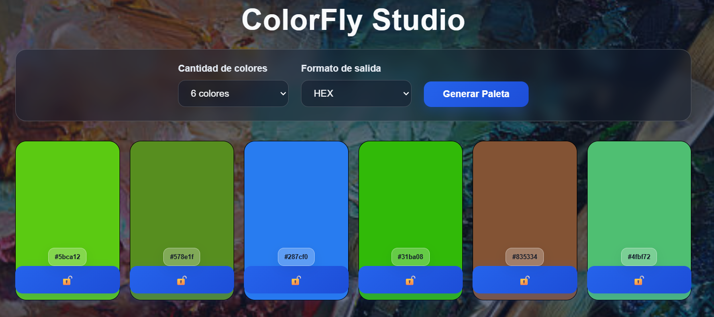

# Generador de Paletas Interactivo
### Proyecto Integrador L1 - Curso FSWEB-80

## 📝 Descripción
Este proyecto consiste en una aplicación web estática e interactiva que permite generar paletas aleatorias de colores en tiempo real. La interfaz le permite al usuario seleccionar una cantidad específica de muestras y alternar de forma dinámica el formato de visualización de los códigos de color generados.

## 🎯 Objetivo
El propósito principal de la aplicación es consolidar conocimientos prácticos en HTML5, CSS, JavaScript y manipulación del DOM, creando una herramienta utilitaria, fluida y accesible.

## ⚡ Funcionalidades
* **Generación Dinámica:** Creación de combinaciones cromáticas aleatorias instantáneas mediante un botón principal.
* **Control de Muestras:** Selectores integrados para renderizar paletas de 6, 8 o 9 colores en pantalla.
* **Formatos Flexibles:** Conversión y visualización dinámica de códigos en formatos HEX y RGBA.
* **Accesibilidad Integrada:** Estructura optimizada mediante etiquetas semánticas, estados `:focus-visible` claros para navegación por teclado y validación de contraste UI.
* **Diseño Responsivo:** Interfaz optimizada y pensada para resoluciones de escritorio (Desktop).

## 🛠️ Tecnologías Utilizadas
* **Frontend:** HTML5, CSS, JavaScript.
* **Control de Versiones & Entorno:** Git, GitHub.
* **Despliegue / DevOps:** GitHub Pages.

## 🚀 Despliegue y Demo
Puedes interactuar con la aplicación en vivo a través del siguiente enlace:
🔗 [Demo en GitHub Pages](https://eduardomaciel1.github.io/ProyectoL1-EduardoMaciel-FSWEB-80/)

---

## 💻 Desarrollo Asistido por IA (AI-Assisted Development)

Durante el desarrollo utilicé IA como mentor y apoyo para comprender y revisar distintas partes del proyecto. Las consultas me ayudaron a pensar la organización de la aplicación y a entender la lógica; las decisiones y la implementación sobre lo aprendido con el código quedaron a mi cargo.

| Tema consultado | Orientación recibida |
| :--- | :--- |
| **Arquitectura y organización** | Conversamos sobre cómo ordenar las partes de la aplicación y separar la interfaz de la lógica para que el código sea más claro y cómodo de mantener. |
| **Algoritmos de color** | Recibí explicaciones para comprender la generación de colores en HSL y la conversión de sus valores a otros formatos. |
| **Presentación y legibilidad** | Revisamos cómo organizar visualmente los controles y las muestras de color para que la interfaz resulte más clara de usar. |
| **Repositorio y documentación** | Recibí orientación sobre GitHub Pages, la estructura del README y cómo incluir capturas de pantalla. |

La IA proporcionó explicaciones, preguntas guía y sugerencias; no implementó ni reorganizó los archivos HTML, CSS o JavaScript de la aplicación. Sí recibí ayuda para redactar y revisar esta documentación.

---

## 🧠 Decisiones Técnicas
* **HTML Semántico:** Uso de etiquetas estructurales nativas para organizar la interfaz de forma lógica y legible.
* **Manipulación del DOM:** Toda la lógica de renderizado, escucha de eventos y actualización de estilos se maneja con JavaScript vanilla.
* **Lógica Cromática:** Los colores se calculan internamente en el espacio de color HSL para garantizar una distribución armónica, convirtiéndose al vuelo según la preferencia seleccionada.
* **Estilos Modulares:** Se aplicaron hojas de estilo externas en CSS para mantener una separación estricta entre la lógica de negocio y la capa de presentación.

## 📦 Cómo Ejecutar el Proyecto Localmente
1. Clonar o descargar este repositorio en tu máquina local.
2. Abrir la carpeta del proyecto.
3. Ejecutar el archivo `index.html` directamente en tu navegador preferido (o utilizar una extensión de servidor local como *Live Server* para una experiencia de desarrollo óptima).

## 📋 Instrucciones de Publicación (GitHub Pages)
1. Ingresar al repositorio en GitHub.
2. Navegar a la sección **Settings** y seleccionar el apartado **Pages** en el menú lateral.
3. Configurar la rama principal (`main` o `master`) como la fuente de publicación para la carpeta raíz (`/root`).
4. Guardar los cambios y esperar a que el pipeline de GitHub genere la URL pública definitiva.

## 📸 Capturas de Pantalla / Media

## 👤 Créditos y Autoría
* **Proyecto:** Entrega obligatoria del módulo de Proyecto Integrador L1.
* **Estudiante:** Eduardo Maciel.
* **Estado:** Terminado y publicado.
